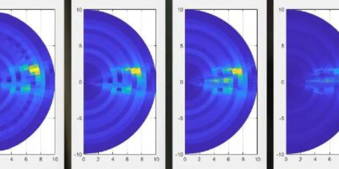

# Millimeter Wave 4D Imaging Radar: Embracing the New Era of Massive MIMO Perception [with MATLAB Code]

Millimeter Wave 4D Imaging Radar: Embracing the New Era of Massive MIMO Perception The camera is adept at recognizing colors and textures, the LiDAR can precisely depict three-dimensional contours, while the millimeter wave radar stands out with its all-weather, all-time capabilities - whether it's pouring rain or thick fog, it can work stably.
However, traditional radar has a fatal flaw: it can only see "points" and not "shapes".
Nowadays, a technology named 4D imaging millimeter wave radar is breaking this deadlock. It can not only tell you "there is an obstacle ahead", but also "this is a pedestrian moving left at a speed of 5 km/h". This article will take you to deeply understand the core mystery of this technology.
1. What is a "4D" radar? Traditional onboard radars can only output three-dimensional information about targets: distance, azimuth angle, and velocity (known as 2D+1D). However, a true 4D radar adds an essential dimension: elevation angle.
Dimensions
Traditional radar
4D radar
Distance (Range)
✓  
✓  
Azimuth
✓  
✓  
Speed (Doppler)
✓  
✓  
Pitch (Elevation)
✗  
✓  
With the information of pitch angle, radar can distinguish "the bridge hole in front" and "the large truck across the road" — which is completely impossible to achieve in traditional radar. With the addition of velocity dimension, it forms a complete 4D perception capability of 3D space + Doppler velocity.
II. The Advantages of Millimeter Wave Technology 4D imaging radar operates at the 77 GHz millimeter wave frequency band. This choice of frequency band is not accidental:
•  
Short wavelength (about 4 mm): High-angle resolution can be achieved with a small antenna array.
•  
Bandwidth: 76-81 GHz frequency band provides up to 4 GHz of available bandwidth, meaning centimeter or even sub-centimeter resolution at distances.
•
Miniaturization of Antennas: Millimeter wave antennas are extremely small, facilitating integration on chip arrays.
It is precisely these characteristics of millimeter waves that make it possible to deploy large arrays of antennas on compact vehicle platforms.
III. Core Technology One: FMCW Waveform - The Foundation of Range Measurement 4D Imaging Radar's core waveform is FMCW (Frequency Modulated Continuous Wave).
Imagine a car accelerating at a constant speed: If you record the speed every second, you can infer the distance traveled by "speed difference". The principle of FMCW radar is similar:
•
An "chirp signal" (frequency chirp) is transmitted with its frequency linearly increasing over time.
•
The signal hits the target and returns, and since electromagnetic wave propagation takes time, the returned signal's frequency is lagging behind the current transmitting frequency.
•
By mixing the transmitting and receiving signals, a beat signal is produced.
•
The size of this beat signal is directly proportional to the target distance.
How fine can a radar resolve two targets? This entirely depends on the bandwidth:
ΔR = c / (2B) where c is the speed of light, and B is the bandwidth. This formula states:
•
Bandwidth 150 MHz → Distance resolution about 1 meter
•
Bandwidth 1 GHz → Distance resolution about 0.15 meters
•
Bandwidth 4 GHz → Distance resolution about 0.0375 meters
The wider the bandwidth, the more detailed it can be. That's why a large bandwidth is one of the core metrics pursued by 4D imaging radar.
IV. Core Technology Two: MIMO and Virtual Arrays - The Magic of Angle Resolution If the big bandwidth is the radar's "prescription eyeglasses", then the large MIMO array is its "broad-beamed mirror" - it allows the radar to precisely determine which direction the target comes from.
MIMO's basic idea is MIMO (Multiple Input Multiple Output), a mature technology in the field of communication, which has been cleverly introduced into radar:
•  
With N transmitting antennas and M receiving antennas
•  
Each signal emitted by the transmitting antenna is reflected by the target and then received by all receiving antennas.
•  
This results in N × M independent "space measurement channels".
Virtual Array: The Magic of Spatial Convolution in MIMO Radar
Virtual Element Position = Transmit Element Position + Receive Element Position.
•  
4 transmitting antennas + 4 receiving antennas
•  
By proper layout, 4x4 = 16 equivalent virtual elements can be generated.
•  
Using 8 physical channels, achieved 16 channel angle resolution.
This is equivalent to using a "combination punch" method, allowing the limited physical hardware to be "expanded" several times.
The larger the aperture of the virtual array for angle resolution, the higher the angle resolution:
Δθ ≈ λ / (D × cosθ) where λ is the wavelength, D is the virtual aperture length. The large-scale MIMO configuration with 128 transmitters and 128 receivers can generate up to 16,384 virtual channels—enabling millimeter-level spatial resolution.
V. Core Technology Three: FMCW vs PMCW - A Comparison of Two Waveforms Besides FMCW, another waveform that has attracted significant attention is PMCW (Phase Modulation Continuous Wave). The differences between them can be understood through a key tool - the fuzzy function.
The fuzzy function is like the "fingerprint" of a radar waveform, describing its autocorrelation characteristics in two dimensions: time delay (distance) and Doppler (velocity).
•  
The FMCW's ambiguity function is "blade-shaped": there exists coupling on the distance-velocity plane, i.e., the measurement of distance and velocity will affect each other. Advantage: High resolution, simple hardware. The disadvantage is the presence of distance-Doppler coupling, which causes blurring for distant high-speed targets.
•  
PMCW's fuzzy function presents a "pincer-shaped" pattern: measurements of distance and velocity are completely decoupled. The advantage is that both distance and velocity can be measured with high precision independently; the disadvantage is that it requires higher hardware requirements, and sidelobe suppression also needs to be meticulously designed.
Currently, FMCW remains the mainstream choice for 4D imaging radar due to its mature hardware ecosystem and superior distance resolution.
VII. Core Technology Four: MIMO vs. Phased Array —— Two Beamforming Strategies
Phased array radars form narrow beams by simultaneously controlling the phase of all elements through phase shifters, much like a flashlight focusing light.
MIMO radars adopt a completely different strategy: the transmitting antennas operate in parallel, each radiating from a wide beam, allowing the receiving end to achieve "digital beamforming" through signal processing.
The core difference between the two lies in:
Features
Phased array
MIMO
Transmit beam
Narrow beam (high gain)
Wide beam (low gain)
Angular resolution
Depends on the number of physical elements
Depends on the number of virtual elements
Simultaneous scanning capability
Requires mechanical or electronic scanning
Can cover a large area simultaneously
Hardware complexity
Needs phase shifters
Requires multichannel digital processing
The unique advantage of "N+M physical channels achieving N×M resolution" makes MIMO the fundamental reason why it becomes the preferred architecture for 4D imaging radar.
VIII. Simulations Showcase 4D Imaging: A Vivid Example
We use a specific simulation case to demonstrate the power of 4D imaging.
Scenario setup•
Three targets: a pedestrian (circling), a pyramid, a sphere
•
Radar configuration: 128 transmitters, 128 receivers, large MIMO, 77 GHz millimeter wave, 600 MHz bandwidth
•
Target distance: approximately 75-150 meters
Imaging process 1
Signal synthesis: For each scattering point, calculate its direction angle and distance, synthesize the radar echo signal containing both distance and angle information.
2
3D FFT processing: Perform FFT on the distance dimension (fast time), transmit antenna dimension, and receive antenna dimension separately to obtain the three-dimensional spectrum of distance-azimuth-pitch.
3  
Peak detection: Finding peaks in the three-dimensional spectrum and extracting the precise positions of each target.
4  
Coordinate Reconstruction: Convert spherical coordinates to global Cartesian coordinates, obtaining complete 3D point cloud.
The reconstructed point cloud clearly displays the 3D spatial forms of three targets: the outlines of pedestrians, the geometric structure of the pyramid, and the spherical characteristics of the ball - this is not information about "one point", but a true 3D image.
VIII. Engineering Wisdom in the Layout of Commercial Radar Antennas
12x16 configuration.
12 transmit antennas + 16 receive antennas, producing approximately 192 virtual elements.
•  
Characteristics: compact, cost-effective, suitable for mid-range applications.
48×48 configuration •
48 transmitting antennas + 48 receiving antennas, producing approximately 2304 virtual elements.
•  
Large-scale configuration brings excellent imaging quality, with more detailed pedestrian point cloud details.
16x16 configuration (two variants)
Different geometric layouts have their own advantages and disadvantages in virtual array coverage.
•  
Exhibits the trade-offs in engineering design: uniformity vs. aperture size vs. hardware complexity
These designs reflect the core idea of practical commercial radars (such as TI AWR2243 cascading solutions): maximizing the effective aperture and angle resolution of virtual arrays under limited physical hardware costs and installation space constraints.
IX. Synthetic Aperture Radar (SAR) Imaging: Another Approach to 3D Perception Apart from MIMO arrays, SAR (Synthetic Aperture Radar) is another method for achieving high-resolution 3D imaging.
The core idea of SAR is to utilize the motion of the radar platform, "walking while taking pictures", to synthesize and process the echo signals collected at different locations along the way, effectively constructing a much larger virtual aperture than a physical antenna.
The key algorithm: The complex problem of propagating spherical wavefronts through a 2D scanning aperture, which is the ω-k domain, is transformed into a simple mathematical structure. Non-uniformly sampled data is mapped onto a uniform grid via Stolt interpolation, and then directly reconstructed in 3D using a three-dimensional Fast Fourier Transform (FFT)—this process is like assembling a pile of fragments into a high-definition photo.
Simulation example: On a 2m×2m scanning aperture, with 256×256 sampling positions and a broadband signal of 9-15 GHz, a 3D image of pyramid, sphere, and pedestrian was successfully reconstructed. Although SAR requires long acquisition times, its principle is clear and its resolution outstanding, making it widely used in ground-based radar imaging and security detection scenarios.
Beam pattern: The "personal signature" beam pattern (Beampattern) of an antenna array is the radiation/reception gain map at different directions of the antenna array, which directly determines the radar's "viewing angle" characteristics.
Key indicators•  
Main lobe width: The narrower the main lobe, the higher the angle resolution. For an N-element uniform linear array, the half power beam width is approximately θ_BW ≈ 0.886 × λ / (N × d)•  
Sidelobe level: The lower the sidelobe, the fewer the false targets, and the greater the dynamic range  
•  
Grating lobe: Appears when the element spacing exceeds λ/2, causing angle ambiguity—"an object appears as multiples"  
From a linear array to a planar array (URA), extending one-dimensional linear arrays to two-dimensional uniform rectangular arrays (URA), can form beams in both azimuth and elevation angles:  
•  
An 12×12 URA generates a wider main lobe  
•  
A 32×32 URA significantly narrows the main lobe, significantly improving the angle resolution capability  
Two-dimensional beam patterns are like the "spotlight" of a radar in space, with larger arrays allowing for more concentrated light and clearer vision.
Systematic perspective: The performance of a 4D imaging radar is not determined by a single parameter but rather a system of multi-parameter interactions:
Requirements  
Key parameters  
Relationships  
Further refined distance resolution
Increase Bandwidth B  
ΔR = c/(2B)  
More Accurate Angle Recognition  
Increase Virtual Aperture/Array Number  
Δθ ≈ λ/(D·cosθ)  
Farther Probe Distance  
Improve Transmit Power, Decrease Noise  
Radar Equation Constraint  
Faster Speed Measurement  
Shorten Chirp Period  
vmax = λ/(4·Tc)  
More Virtual Channels  
Increase Tx/Rx Numbers  
Nva = Nt × Nr  
Designing an excellent 4D imaging radar requires finding the best balance among all these parameters—a core topic that is continuously explored by both academia and industry.  
12. Application Prospects: From Laboratory to Road 4D Imaging Millimeter Wave Radar Applications are far beyond autonomous driving:  
•  
Intelligent Traffic: Perception units on the roadside for real-time traffic flow monitoring  
•  
Security Surveillance: Border protection around airports, ports, and borders  
•  
Industrial Inspection: Robot 3D environment perception in factory automation  
•  
Drone Avoidance: Small-scale 4D radar endows drones with all-weather autonomous flight capabilities  
•  
Medical Monitoring: Non-contact vital signs detection (breathing, heartbeat)  
With the maturity of Massive MIMO technology and the reduction in millimeter wave chip costs, 4D imaging radars are transitioning from "high-end optional" to "standard configuration."  
Conclusion From FMCW waveform to MIMO virtual array, from beamforming design to 3D/4D image reconstruction, millimeter wave 4D imaging radars have gathered decades of research achievements in radar technology, representing a significant leap in perception technology.  
It has transformed radar from a "sensor" into an "imaging device"—no longer just outputting a few discrete detection points but painting out a complete 4D perception scene that includes distance, bearing, elevation, and velocity.  
On the road to L4/L5 full autonomous driving, 4D imaging millimeter wave radars are playing an increasingly irreplaceable role.
📚 References Recent Advances in mmWave 4D Imaging Radars: A Leap Towards Massive MIMO in Sensing, Proceedings of the IEEE, 2025. Authors: Masoud Dorvash, Mohammad Alaee-Kerahroodi, Bhavani Shankar Mysore, Björn Ottersten, Christian Waldschmidt, A. Lee Swindlehurst, Reinhard Feger

## Images

<!-- PAYMENT_BLOCK -->

## Get this dataset

- Payment link (Stripe): [Buy now](https://buy.stripe.com/3cs8yP7sY87d0vu9AB)
- Payment QR code: 

<!-- /PAYMENT_BLOCK -->
